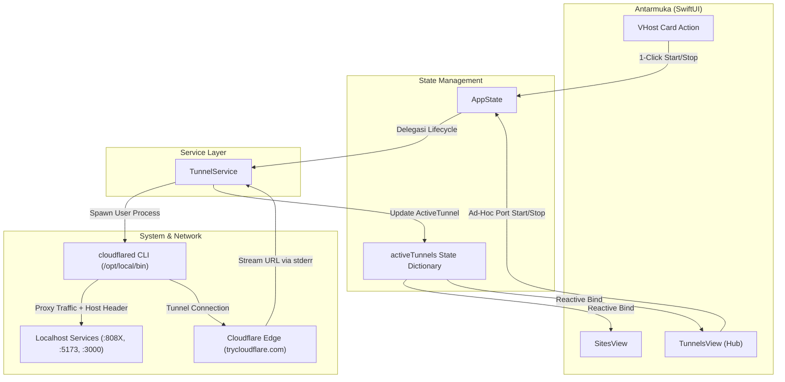

# Dokumen Desain: Cloudflare Quick Tunneling (1-Click Localhost Expose & Tunnels Hub)

- **Tanggal:** 15 November 2026
- **Status:** Approved Draft (Refined via Brainstorming & Review)
- **Target Platform:** macOS Monterey 12.0+ (`x86_64` Intel & `arm64` Apple Silicon)
- **Komponen Utama:** Swift Native (`SwiftUI` + `AppKit`), Cloudflare Tunnel CLI (`cloudflared`)
- **Lokasi Repositori:** `/Users/adijaya/MyFiles/Projects/macports-control-center`
- **Fitur Terkait:** Tab Sites (`SitesView.swift`), Tab Tunnels (`TunnelsView.swift`), State Management (`AppState.swift`), Service Layer (`TunnelService.swift`), Navigation (`MainWindowView.swift`)

---

## 1. Latar Belakang & Masalah (*Intent and Context*)

Pengembang web di lingkungan lokal (Laravel, PHP, Vue/Vite, Next.js, Node.js) yang dikelola melalui MacPorts Control Center secara rutin membutuhkan akses publik terhadap situs lokal mereka untuk:
1. **Testing Webhook Pihak Ketiga:** Integrasi payment gateway (Midtrans, Xendit, Stripe), bot webhook (Telegram, WhatsApp, GitHub).
2. **Demo Klien / Stakeholder Preview:** Membagikan tautan sementara yang aman dan dapat dibuka di mana saja tanpa konfigurasi port forwarding / router NAT.
3. **Testing Responsif Lintas Jaringan:** Menguji tampilan dan fungsionalitas web pada perangkat fisik di luar jaringan WiFi lokal.
4. **Ad-Hoc Port Dev Servers:** Menguji server frontend mandiri seperti Vite (`5173`), Next.js (`3000`), atau API microservices (`8000`) yang berjalan di luar Nginx.

Solusi alternatif konvensional memiliki friksi tinggi:
- **Ngrok Free:** Membutuhkan pendaftaran akun dan auth token, batasan waktu koneksi/bandwidth, serta menampilkan halaman peringatan intersitial browser (*"You are visiting an ngrok tunnel..."*) yang merusak payload webhook JSON.
- **Port Forwarding / Public IP:** Rumit, tidak aman bagi jaringan rumahan, dan sering terhalang CGNAT provider internet.
- **BeyondCode Expose:** Layanan cloud publiknya membutuhkan langganan berbayar untuk fitur stabil.

**Cloudflare Quick Tunnel (`cloudflared tunnel --url ...`)** menyediakan solusi optimal:
- **100% Gratis & Bebas Biaya:** Disediakan resmi oleh Cloudflare tanpa batasan durasi sesi atau batas kuota bandwidth wajar.
- **Zero-Account & Zero-Domain:** Menghasilkan subdomain HTTPS valid (`https://*.trycloudflare.com`) secara instan tanpa perlu registrasi akun Cloudflare atau membeli domain.
- **Tersedia Resmi di MacPorts:** Paket `cloudflared @2026.10.7` tersedia resmi di repositori MacPorts (`/opt/local/bin/cloudflared`).

---

## 2. Goals, Non-Goals, dan Anti-Goals

### A. Goals (Sasaran Utama)
1. **Dual-Tier UI Experience (Kombinasi In-Context & Central Hub):**
   - **In-Context di Tab Sites:** Setiap kartu Virtual Host di `SitesView` memiliki tombol aksi **"Tunnel"** yang otomatis menjalankan tunnel untuk port vhost tersebut (misal `8080`, `8081`). Header `SitesView` juga memiliki tombol cepat `[ ⚡ Tunnel Custom Port ]`.
   - **Dedicated Tunnels Hub di Sidebar:** Tab baru **Tunnels** (`TunnelsView`) pada sidebar navigasi utama untuk mengelola seluruh tunnel aktif secara terpusat, menyediakan launcher ad-hoc custom port (Vite `5173`, Next.js `3000`), preset port cepat, dan tombol global **"Stop All Tunnels"**.
2. **Lifecycle Asinkron Tanpa Freeze:** Eksekusi proses `cloudflared` berjalan di background via asynchronous streaming `Process`, menangkap URL publik `https://*.trycloudflare.com` secara instan lewat regex dari `stderr`.
3. **Indikator Visual & Kontrol Penuh:**
   - Badge status hidup (indikator hijau: *● Live Tunnel*).
   - Display URL publik monospaced dengan tombol pintas: **Copy URL** (dengan feedback salin) dan **Open in Browser**.
   - Tombol **Stop Tunnel** untuk menghentikan proses kapan saja.
   - Badge counter di sidebar navigation item `Tunnels` yang menampilkan jumlah tunnel yang sedang aktif (`status == .active`).
4. **Dukungan SSL & Host Header Routing yang Robust:**
   - Mendukung proxy vhost SSL/HTTPS (`https://127.0.0.1:<port>`) dengan argumen `--no-tls-verify`.
   - Mengirimkan `--http-host-header` yang sesuai (`serverName` vhost atau `localhost` untuk server frontend dev seperti Vite 5+) agar tidak terjadi `400 Bad Request` atau penolakan host header.
5. **Deteksi Robust Binary `cloudflared`:**
   - Memeriksa path prioritas: `/opt/local/bin/cloudflared`, `~/.local/bin/cloudflared`, `/usr/local/bin/cloudflared`, atau melalui resolusi `PATH`.
   - Jika belum terpasang, UI memberikan panduan dan tombol 1-klik untuk menginstal via MacPorts (`sudo port install cloudflared`) dengan output dialirkan ke Terminal Drawer.
6. **Multi-Tunnel Bersamaan:** Mendukung beberapa port / vhost ditunnelkan secara serentak (misal port `8081` untuk Laravel backend dan port `5173` untuk Vite SPA).
7. **Pembersihan Bersih (*Graceful Exit*):** Mematikan seluruh proses child `cloudflared` ketika aplikasi ditutup (`applicationWillTerminate`) atau saat tombol Stop ditekan agar tidak ada proses *zombie/orphan*.

### B. Non-Goals (Bukan Cakupan)
- Tidak menggunakan fitur QR Code atau generator gambar (fokus utama adalah URL web, tombol copy, dan open di browser).
- Tidak mengelola Cloudflare Named Tunnel permanen (Zero Trust Dashboard / token credentials akun Cloudflare).
- Tidak mengonfigurasi Cloudflare Access authentication (login Google/GitHub gate di depan tunnel).
- Tidak memodifikasi file konfigurasi Nginx vhost (`/opt/local/etc/nginx/servers/*.conf`) karena tunnel bekerja langsung mem-proxy port HTTP yang terbuka.

### C. Anti-Goals (Hal yang Dilarang)
- **Dilarang memblokir UI Thread:** Dilarang menggunakan pemanggilan sinkron (`waitUntilExit`) pada main thread.
- **Dilarang mengeksekusi dengan `sudo`:** `cloudflared tunnel --url ...` adalah perintah level pengguna biasa dan wajib dijalankan tanpa hak istimewa root.
- **Dilarang hardcode single binary path:** Jangan hanya memeriksa satu lokasi tetap tanpa fallback.

---

## 3. Pilihan Pendekatan & Keputusan Arsitektur (*Approaches*)

Tiga pendekatan telah dievaluasi untuk integrasi fitur ini:

1. **Pendekatan 1: Terintegrasi Hanya di Tab Sites**
   - Menempatkan semua kontrol tunnel di tab Virtual Hosts (`SitesView`).
   - *Kelebihan:* Ramping, tidak menambah item sidebar.
   - *Kekurangan:* Pengguna harus membuka tab Sites untuk mengelola port yang sama sekali tidak berhubungan dengan Nginx (misal Vite `5173`). Kurang representatif untuk project non-PHP.

2. **Pendekatan 2: Tab Mandiri "Tunnels" Saja**
   - Menghapus kontrol tunnel dari kartu vhost dan memusatkan semuanya di tab ke-8.
   - *Kelebihan:* Ruang sangat leluasa.
   - *Kekurangan:* Menghilangkan kenyamanan 1-klik saat sedang mengonfigurasi vhost di tab Sites; pengguna harus berpindah tab untuk menyalakan tunnel port vhost.

3. **Pendekatan 3: Kombinasi Dual-Tier (Dipilih oleh Pengguna)**
   - Memberikan kenyamanan 1-klik langsung pada kartu Virtual Host di `SitesView`, sekaligus menyediakan tab mandiri **Tunnels** (`TunnelsView`) sebagai command center terpusat untuk Ad-Hoc Port (Vite, Next.js, Node) dan monitoring multi-tunnel.
   - Keduanya berbagi state reaktif yang sama di `AppState.activeTunnels`.
   - *Alasan Pemilihan:* Memberikan pengalaman pengguna (*developer experience*) terbaik tanpa kompromi fleksibilitas.

---

## 4. Arsitektur Teknis & Komponen



### A. Data Models (`Sources/MacPortsControlCenter/Models/DomainModels.swift`)

```swift
public enum TunnelStatus: String, Codable, Equatable {
    case starting
    case active
    case stopped
    case error
}

public struct ActiveTunnel: Identifiable, Equatable {
    public let id: String // Composite ID, e.g. "port_8081" or "custom_5173"
    public let port: String
    public let label: String // e.g. "portal-berita.test" or "Vite React App"
    public var publicUrl: String?
    public var status: TunnelStatus
    public var errorMessage: String?
    public var startedAt: Date
    public var isVHost: Bool
    public var isSSL: Bool

    public init(
        port: String,
        label: String,
        status: TunnelStatus = .starting,
        isVHost: Bool = false,
        isSSL: Bool = false
    ) {
        self.id = "\(port)_\(label.replacingOccurrences(of: " ", with: "_"))"
        self.port = port
        self.label = label
        self.status = status
        self.startedAt = Date()
        self.isVHost = isVHost
        self.isSSL = isSSL
    }
}
```

### B. Perluasan NavigationSection (`Sources/MacPortsControlCenter/Models/AppState.swift`)

Tambahkan case `.tunnels` pada enum `NavigationSection`:
```swift
public enum NavigationSection: String, CaseIterable, Identifiable {
    case services = "services"
    case sites = "sites"
    case tunnels = "tunnels"   // <-- Tab Baru ke-8
    case php = "php"
    case database = "database"
    case packages = "packages"
    case logs = "logs"
    case docs = "docs"

    public var displayName: String {
        switch self {
        case .services: return "Services & Doctor"
        case .sites: return "Virtual Hosts"
        case .tunnels: return "Tunnels"
        case .php: return "PHP Manager"
        case .database: return "Databases"
        case .packages: return "MacPorts Packages"
        case .logs: return "Server Logs"
        case .docs: return "Documentation"
        }
    }

    public var systemImage: String {
        switch self {
        case .services: return "server.rack"
        case .sites: return "globe"
        case .tunnels: return "antenna.radiowaves.left.and.right"
        case .php: return "chevron.left.forwardslash.chevron.right"
        case .database: return "cylinder.split.1x2"
        case .packages: return "shippingbox"
        case .logs: return "doc.text.magnifyingglass"
        case .docs: return "book"
        }
    }
}
```

### C. Service Pengelola Tunnel (`Sources/MacPortsControlCenter/Services/TunnelService.swift`)

`TunnelService` bertindak sebagai *process supervisor* yang mengelola kamus proses `[String: Process]` (key: `tunnelId`).

Tugas utama:
1. `findBinaryPath() -> String?`: Memeriksa keberadaan file di `/opt/local/bin/cloudflared`, `~/.local/bin/cloudflared`, `/usr/local/bin/cloudflared`, atau via `which cloudflared`.
2. `isCloudflaredInstalled() -> Bool`: Mengembalikan status ketersediaan binary.
3. `static func extractTunnelURL(from log: String) -> String?`:
   Mengekstrak URL publik via regular expression:
   ```swift
   let pattern = "https://[a-zA-Z0-9-]+\\.trycloudflare\\.com"
   ```
4. `startTunnel(port: String, label: String, isVHost: Bool, isSSL: Bool, hostHeader: String?, onUrlDiscovered: @escaping (String) -> Void, onError: @escaping (String) -> Void)`:
   - Membuat objek `Process()`.
   - Mengarahkan `executableURL` ke binary yang ditemukan.
   - Skema target: `let scheme = isSSL ? "https" : "http"`.
   - URL target: `let targetUrl = "\(scheme)://127.0.0.1:\(port)"`.
   - Argumen dasar: `["tunnel", "--url", targetUrl, "--no-autoupdate"]`.
   - Jika `isSSL`: tambahkan `"--no-tls-verify"`.
   - Jika `hostHeader` ada: tambahkan `"--http-host-header", hostHeader`. Jika nil dan bukan vhost (ad-hoc port), gunakan `"--http-host-header", "localhost"` agar Vite 5+ tidak menolak request.
   - Menghubungkan `Pipe()` ke `standardError` (catatan: `cloudflared` mengirimkan log koneksi dan URL publik ke `stderr`).
   - Melakukan pembacaan asinkron baris demi baris menggunakan `readabilityHandler`.
   - Begitu URL ditemukan, panggil callback `onUrlDiscovered(url)`.
5. `stopTunnel(tunnelId: String)`:
   - Mengambil proses aktif dari kamus proses.
   - Mengirimkan sinyal terminasi (`process.terminate()`).
   - Membersihkan objek dan file handle.
6. `stopAllTunnels()`:
   - Menterminasi seluruh proses tunnel yang aktif.

### D. Integrasi UI

#### 1. Tab Sites (`SitesView.swift`)
- **Header:** Tombol `[ ⚡ Tunnel Custom Port ]` di samping `+ New Virtual Host` yang memunculkan sheet ringkas untuk input port dan label custom.
- **Kartu Virtual Host:**
  - Tombol aksi `[ ⚡ Tunnel ]` di action bar bawah.
  - Jika tunnel aktif pada vhost tersebut:
    - Banner sub-seksi biru/cyan monospaced dengan URL `https://xxxx.trycloudflare.com`.
    - Tombol: **Copy URL** (dengan feedback salin), **Open Browser**, dan **Stop Tunnel**.

#### 2. Tab Tunnels Baru (`TunnelsView.swift`)
- **Hero & Header:** Judul "Tunnels Hub" dengan tombol global `[ ⏹ Stop All Tunnels ]`.
- **Expose New Port Panel:**
  - Input field: `Port` (misal 5173) dan `Label` (misal Vite React Dev).
  - Quick Preset Chips: `[ 3000: Next.js ]`, `[ 5173: Vite ]`, `[ 8000: FastAPI ]`, `[ 8080: HTTP Alt ]`.
  - Tombol `[ ⚡ Start Tunnel ]`.
- **Active Tunnels Grid / List:**
  - Menampilkan semua tunnel aktif (baik VHost maupun Ad-Hoc).
  - Target host, status hidup (*Live*), public URL monospaced, tombol Copy URL, Open Browser, dan Stop.
  - Saat dihentikan oleh pengguna, tunnel dihapus dari daftar aktif. Jika terjadi kegagalan/error, item menampilkan pesan error merah dan tombol Dismiss.
- **Empty State:** Desain informatif saat tidak ada tunnel aktif dengan panduan penggunaan.

---

## 5. Keamanan & Guardrails

1. **Unprivileged Execution:** Perintah `cloudflared tunnel` selalu dijalankan sebagai user reguler (`adijaya`). Tidak ada hak root atau sudo yang diberikan ke proses tunneling.
2. **Bound strictly to Localhost:** Target tunneling dikunci strictly ke `http://127.0.0.1:<port>` atau `https://127.0.0.1:<port>` untuk mencegah proxy ke subnet jaringan eksternal yang tidak sah.
3. **No Credential Leaks:** Mode *Quick Tunnel* tidak menyimpan file kredensial atau sertifikat di disk; koneksi bersifat *in-memory ephemeral*.
4. **Lifecycle Cleanup on App Termination:**
   - Di `MainApp.swift` (`applicationWillTerminate`), panggil `appState.stopAllTunnels()`.

---

## 6. Rencana Pengujian (*Testing Strategy*)

1. **Unit Testing (`Tests/MacPortsControlCenterTests/TunnelServiceTests.swift`):**
   - Uji deteksi path binary dengan fallback multi-path (`/opt/local/bin`, `~/.local/bin`, dll.).
   - Uji ekstraksi regex URL `https://*.trycloudflare.com` dari log nyata Cloudflare.
   - Uji pembentukan argumen CLI (HTTP vs HTTPS + `--no-tls-verify`, serta opsi `--http-host-header`).
   - Uji pembuatan model `ActiveTunnel` dan transisi status (`starting` -> `active` -> `stopped`).
2. **Integrasi Test Runner (`TestRunnerMain.swift`):**
   - Daftarkan `TunnelServiceTests` ke `TestRunnerMain.swift`.
   - Jalankan `TEST_RUNNER=1 /tmp/run-all-tests` dan pastikan seluruh test suite (lama dan baru) lulus 100%.
3. **Kompilasi & Build Bundle:**
   - Jalankan `./build-app.sh` untuk memastikan aplikasi terkompilasi dan codesign berhasil.

---

## 7. Keputusan Teknis Builder (*Builder Decisions Made*)
- **Host Header Routing:** Ditambahkan argumen `--http-host-header` otomatis agar virtual host Nginx dan server dev seperti Vite 5+ tidak menolak request karena perbedaan hostname Cloudflare.
- **Dukungan SSL/HTTPS:** VHost dengan SSL otomatis menggunakan `https://127.0.0.1:<port>` dan flag `--no-tls-verify`.
- **Composite ID:** ID unik menggunakan format `port_label` untuk mencegah tabrakan ID.
- **State Cleanup:** Saat pengguna menekan "Stop", tunnel langsung dibersihkan dari daftar aktif agar dashboard tetap rapi; jika terjadi error eksekusi, pesan kesalahan tetap ditampilkan hingga di-dismiss.
- **Tanpa Komponen QR Code:** Seluruh ketergantungan grafis `CoreImage`, views QR popover, dan file generator ditiadakan untuk menjaga kode tetap ramping dan fokus pada copy-paste URL dan browser integration.
